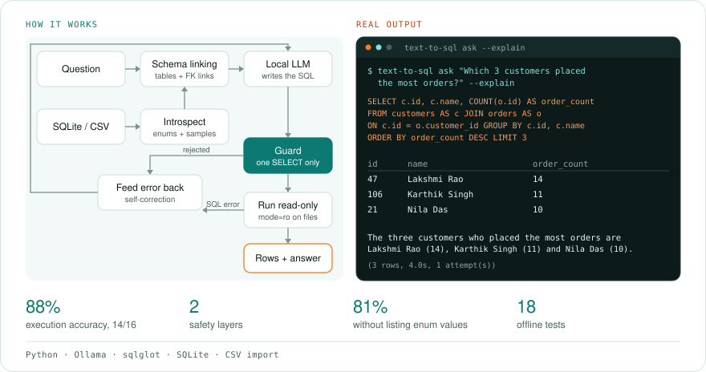
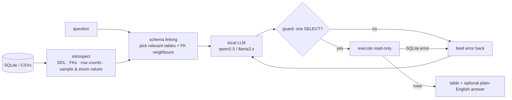

# text-to-sql

**Ask your database questions in plain English and get the answer plus the SQL behind it.** text-to-sql turns questions into SQLite queries with a local LLM. It **can't damage your data** (two independent safety layers), **fixes its own mistakes** by feeding errors back to the model, and comes with a **benchmark** so you can measure accuracy rather than guess at it.

  

<!-- author-banner -->
> **Project 05 of 20** in my AI build series, designed and built by **[Abbishekk DGS](https://abbishekkdgs.tech)**. [See all projects →](https://github.com/Abbishekk-DGS)

```
$ text-to-sql ask "Which 3 customers placed the most orders?" --explain

SQL:
  SELECT c.id, c.name, COUNT(o.id) AS order_count FROM customers AS c JOIN orders AS o
  ON c.id = o.customer_id GROUP BY c.id, c.name ORDER BY order_count DESC LIMIT 3

id  | name          | order_count
----+---------------+------------
47  | Lakshmi Rao   | 14
106 | Karthik Singh | 11
21  | Nila Das      | 10

The three customers who placed the most orders are Lakshmi Rao (14),
Karthik Singh (11) and Nila Das (10).

(3 rows, 4.0s, 1 attempt(s))
```

<!-- overview:start -->
## Overview

<picture>
  <source media="(prefers-color-scheme: dark)" srcset="docs/overview-dark.svg">
  
</picture>

## Interface

It runs in the terminal, with one-off questions or an interactive prompt. There is no graphical app.

| Command | What it does | Options |
|---|---|---|
| `text-to-sql demo` | Builds the sample store database | |
| `text-to-sql ask "<question>"` | Answers one question | `--db`, `--csv`, `--explain` |
| `text-to-sql repl` | Opens a `?` prompt for repeated questions; Ctrl-D quits | `--db`, `--csv`, `--explain` |
| `text-to-sql bench` | Runs the accuracy benchmark | `--db` |

`--model` (default `qwen2.5:3b`) and `--retries` (default 2) go before the command.

Each answer shows the SQL, the result table, the row count, the time and the number of attempts. With `--explain` it also answers in plain English.
<!-- overview:end -->

## Benchmark

16 gold-labelled questions on the bundled store database (filters, joins, aggregation, ranking, dates, `NOT IN` subqueries), scored by **execution accuracy**: does the query return the same rows as the gold query?

| Model (local, via Ollama) | Execution accuracy |
|---|---|
| `qwen2.5:3b` | **14/16 = 88%** |
| `qwen2.5:3b`, without enum listing (ablation) | 13/16 = 81% |

One of the passes needed a retry: the first query failed, the SQLite error went back to the model, and the second attempt was correct. Run it yourself with `text-to-sql --model <any-ollama-model> bench`.

## Safety: two layers

1. **Static guard** (`guard.py`): every query is parsed with [sqlglot](https://github.com/tobymao/sqlglot) into an AST. Only a single `SELECT`/`WITH` statement passes. `INSERT`, `UPDATE`, `DELETE`, `DROP`, `ALTER`, `PRAGMA`, `ATTACH` and stacked statements (`SELECT 1; DROP …`) are rejected anywhere in the tree, including inside CTEs. A `LIMIT` is enforced.
2. **Read-only connection**: the database is opened with SQLite's `mode=ro` URI, so even a hypothetical parser bypass can't write.

A rejected query isn't simply refused. The rejection reason goes back to the model, which usually returns a safe query on the next try.

## How it works



What makes a small model accurate here:

- **Value-aware schema**: text columns include sample values, and **low-cardinality columns list every value** (`status -- one of 'delivered', 'shipped', 'cancelled', 'returned'`), so the model writes `'cancelled'` instead of guessing.
- **Schema linking** keeps prompts small on databases with dozens of tables. It picks the tables whose names, columns or values the question mentions, plus their foreign-key neighbours, so joins still work.
- **Self-correction**: SQLite errors ("no such column: o.unit_price") are precise, and models are good at fixing them.

## Quickstart

```bash
ollama pull qwen2.5:3b          # https://ollama.com

git clone https://github.com/Abbishekk-DGS/text-to-sql && cd text-to-sql
uv sync

uv run text-to-sql demo                                       # builds demo/shop.db
uv run text-to-sql ask "What is the total revenue per category?"
uv run text-to-sql repl --db path/to/your.db --explain        # interactive
uv run text-to-sql ask "average salary by team" --csv people.csv teams.csv
uv run text-to-sql bench                                      # measure accuracy
```

CSV files load into an in-memory database with automatic `INTEGER` / `REAL` / `TEXT` type detection.

## Development

```bash
uv sync --extra dev && uv run pytest -q
```

18 offline tests use a scripted fake LLM: guard bypass attempts, read-only enforcement, the self-correction loop, schema linking, CSV loading and benchmark scoring.

## About the author

Built by **Abbishekk DGS**. More of my work at **[abbishekkdgs.tech](https://abbishekkdgs.tech)** and on **[GitHub](https://github.com/Abbishekk-DGS)**.

## License

MIT © Abbishekk DGS
